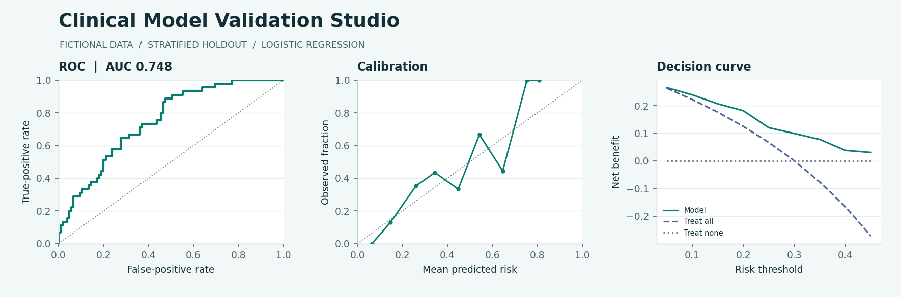

# Clinical Model Validation Studio

A local Python app for evaluating binary risk predictions. Supply a column of existing probabilities, or fit L2-regularized logistic regression and evaluate it on a stratified holdout.



## Run the demo

From the project directory, using Python 3.12:

```bash
python -m venv .venv
source .venv/bin/activate
python -m pip install -r requirements-ui.txt
python -m streamlit run app.py
```

On Windows PowerShell, activate with `.\.venv\Scripts\Activate.ps1`. Open the local URL printed by Streamlit and run the included fictional example. No account or API key is needed.

To run the same workflow without the browser, install `requirements.txt` and use:

```bash
python -m cmvs examples/demo.csv --outcome event_30d --event yes \
  --numeric age baseline_score --categorical group --bootstrap 200

python -m cmvs examples/demo.csv --outcome event_30d --event yes \
  --probability fixed_risk
```

The command writes JSON to standard output. For the fictional example, run `mkdir -p demo-output` and add `--output demo-output/report.json`; the CLI will not overwrite an existing file. Reports include row-level predictions, not just metrics. Keep non-demo datasets and exports outside the checkout. Git ignore rules are a backup, not a privacy control: they do not protect files that are already tracked or added by force. Review staged files before committing.

## Workflow

- **Input:** UTF-8 CSV, up to 1 MB, 5,000 rows and 60 columns. Use one row per independent observation. Choose a binary outcome and its event label. Categorical codes such as `01` are read as text. Missing outcomes are excluded and counted.
- **Preparation:** split before fitting transformations. Learn imputation values, scaling, and category levels on training rows only. Inspect the preparation audit for dropped predictors and data issues.
- **Evaluation:** review ROC AUC, average precision, Brier score, log loss, grouped calibration, and net benefit against treat-all and treat-none. The fitted-model mode also reports metrics for a constant risk equal to the training event fraction.
- **Existing probabilities:** match the supplied probabilities to the chosen event label. This mode does not fit a model, split the data, or verify how those probabilities were obtained. Use probabilities generated without fitting on the evaluation rows if you want to assess generalization.
- **Uncertainty:** optional percentile bootstrap intervals resample evaluation rows with the probabilities fixed. They do not measure uncertainty from retraining, tuning, or selecting a model.

The 600 fictional observations are generated by [examples/make_demo.py](examples/make_demo.py). With the default split (450 training, 150 holdout), the logistic model's ROC AUC is 0.748 and its Brier score is 0.177. These numbers demonstrate the software, not clinical performance.

## Limits

A random holdout is internal validation. It does not test transportability. Repeated patients, site clustering, temporal prediction, censoring, and case-control sampling require a different split or evaluation design. Use predictors available at the stated prediction time. Do not tune settings on the holdout and report that same holdout as independent. Calibration is displayed in ten fixed-width bins; calibration slope and intercept are not estimated. The app does not de-identify files or support clinical decisions.

This Python edition covers the core analytical workflows of the [previous web version](https://github.com/YangSM2026/clincal-model-validation-studio/tree/c49e6d6f44947afe90e587c4724feeba0c0b1451). It does not carry over hosted sign-in, database storage, standalone multicategory preparation, or the original subgroup and multi-model dashboards. The app listens on loopback by default.

## Tests

```bash
python -m unittest discover -s tests -v
```

The suite covers CSV parsing, training-only fitting, metrics and net benefit, and both CLI workflows. Installing `requirements-ui.txt` also enables the Streamlit smoke tests.

MIT license.
